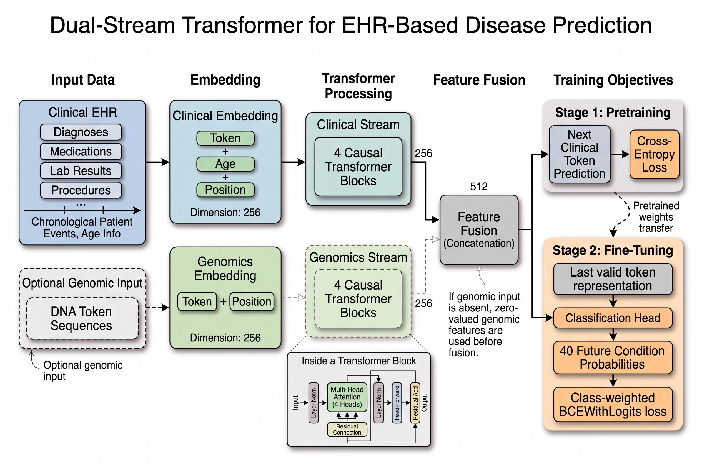

# Dual-Stream EHR Transformer

A custom causal transformer architecture designed to model longitudinal Electronic Health Records (EHR) and genomic sequence data to forecast long-term patient health trajectories.

This repository contains the code, data processing scripts, and training pipeline for predicting 40 distinct incident clinical conditions five years into the future, utilizing the fully synthetic Synthea dataset.

## Project Overview

The core objective of this project is to model a patient's medical history as a stream of timestamped clinical events (diagnoses, medications, procedures, and labs). The model predicts which *new* clinical conditions will be diagnosed in the five years following a specific "anchor date" (defined as five years prior to the patient's last recorded encounter). Conditions pre-existing before the anchor date are dynamically masked to ensure predictions strictly represent incident occurrences.

**Hugging Face Hub:** [PramitDutta1999/ehr-dual-stream-transformer](https://huggingface.co/PramitDutta1999/ehr-dual-stream-transformer)

## Model Architecture



The `DualStreamEHRTransformer` is a lightweight, highly optimized causal transformer (~8.1M parameters). 
* **Streams:** Features a dedicated clinical stream and a parallel genomic stream, fused via linear projection.
* **Missing Modality Handling:** Utilizes dynamic zero-padding to safely process patients lacking DNA sequencing data without destabilizing batch matrix multiplications.
* **Specifications:** 4 Transformer layers, 4 attention heads, 256 hidden dimension, and a vocabulary size of 1,362 tokens.

## Dataset

The model is trained entirely on the synthetic **Synthea** dataset, ensuring structural privacy while mimicking complex biological correlations.
* **Structured Clinical Data:** Multi-table CSVs (encounters, conditions, medications, procedures).
* **Genomic Data:** Un-split patient DNA sequences.
* **Task:** Multi-label binary classification across 40 target clinical conditions.

## Training Pipeline

The training workflow consists of a highly structured two-stage pipeline tracked via Weights & Biases:

1. **Stage 1: Next-Token Pre-Training**
   The model learns the sequential grammar of clinical timelines using a next-event objective on the pre-anchor data.
2. **Stage 2: Multi-Label Fine-Tuning**
   The pre-trained core is fine-tuned using Binary Cross-Entropy (BCE) loss to predict the 40 future target conditions. A custom on-the-fly mask forces the loss associated with pre-existing conditions to zero, preventing the model from "predicting" diseases the patient already has. 
   * **Best Hyperparameters:** Learning Rate: 0.0001, Batch Size: 32.

## Results & Evaluation

The model was evaluated on a held-out test cohort where the patient timelines were pre-truncated at the anchor date and outcomes were strictly hidden. 

Based on the optimized validation set runs:
* **Macro AUROC:** 0.7482
* **Mean Average Precision (mAP):** 0.2370
* **Threshold Accuracy (0.5):** 81.84%

The mAP of 0.2370 highlights the inherent difficulty of forecasting highly sparse, multi-label clinical targets over a long-term 5-year horizon.

## Explainability & Interpretability

To break the "black box" nature of the transformer, the repository includes a standalone explainability pipeline. By running a forward pass on the test set, the script extracts the attention weights from the final Transformer layer. It filters and decodes the **top 10 input tokens** with the highest attention weights for the highest-probability target condition, mapping them onto clear, human-readable heatmaps to explicitly show which clinical events drove the model's prediction.

## Environmental Impact

AI research has an environmental cost. Carbon emissions for this project were estimated using the Machine Learning Impact calculator, assuming equivalent Google Cloud Platform usage as a proxy for the actual cluster.

* **Compute Infrastructure:** Digital Research Alliance of Canada (Rorquial cluster)
* **Hardware:** 1x NVIDIA H100 80GB GPU
* **Total Training Time:** ~1.5 GPU hours (including full hyperparameter grid search)
* **Carbon Emitted:** 0.52 kg CO2 eq. (Equivalent to 2.1 km driven by an average gasoline-powered car).

## How to Run

1. **Install Dependencies:**
   ```bash
   pip install -r requirements.txt
   ```
2. **Train the Model:**
   Submit the training job via the provided SLURM script:
   ```bash
   sbatch scripts/submit_train.sh
   ```
3. **Generate Explainability Heatmaps:**
   ```bash
   python scripts/generate_attention_heatmaps.py
   ```
